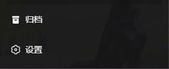
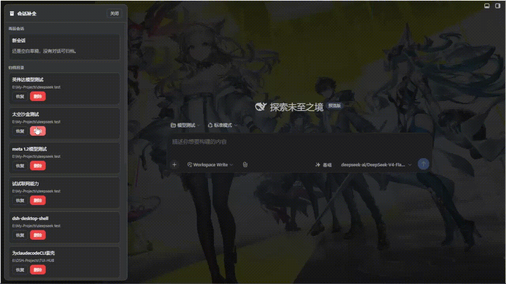
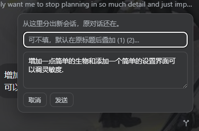
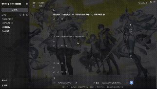

# dsh-session-plus

[中文](README.md) | English

[](https://awesome-dsh-plugin.com) [](https://dshfind.com/zh/plugins/SZMY-haruhi/dsh-session-plus?ref=badge)

Session completion for [DeepSeek Harness](https://github.com/deepseek-ai/deepseek-harness): sidebar archive directory, restore to the original workspace slot, delete, and branch conversation.

Stock DSH can already archive a session, but it has no UI to list, unarchive, or delete. I built this plugin to fill those operations. Everything goes through public slots and the workspace domain. It does **not** patch `@deepseek-ai` packages, and it does not inject DOM into the native View options menu.

Open **Archive** next to Settings at the bottom of the sidebar.

<p align="center">
  
</p>

## Known failure (read this first)

This is not a one-version regression. I reproduced it across multiple builds of this plugin, and other community archive plugins hit the same class of bug. The root cause is DSH session persistence: `tool` / `result` events must carry `source.kind = tool` and a `callId`. Archiving while a tool call is still in flight (the host will `clear()` / unbind) can write an illegal event. A log that is already corrupt cannot be repaired by this plugin — delete it.

What I actually tested:

| Scene | Result |
| --- | --- |
| **Scene 1**: archive after the turn has finished, then restore | **Does not fail.** Survives a restart. |
| **Scene 2**: archive mid-answer on a long write with **no tools**, then restore | **Does not fail.** The answer can finish. Survives a restart. |
| **Scene 3**: archive **while a tool call is in progress**, then restore | **Always fails.** |
| Delete | I have not found remaining bugs. |
| Branch conversation (Edit and branch) | I did not hit a bug on the paths I tried. |

After Scene 3, the client commonly shows:

```
历史加载失败：conversation Context 9:tool-call received more than one start Match（internal）
```

After a server restart:

```
history unavailable
SessionPersistenceCorruptionError: ... message must have tool source（internal）
```

So: **do not archive while a tool is still running.** Wait for the turn to finish, or stop it first. A blank “New session” cannot be archived anyway. The plugin tries to wait until idle (including `runningCalls` / `partial`, up to about 30 seconds) before archive; on timeout it tells you to wait or stop. That does not cover every timing. If the log is already broken, restore is useless — just delete that session.

## Install

npm (stable, [official recommendation](https://deepseek-harness.github.io/deepseek-harness/en/develop/basic/publish)). Please take **0.1.2**. The npm `0.1.0` was only a name-hold. `0.1.1` still reads `list()` as raw headers and deletes through `locate()`, which does not match DSH 0.1.5+ session logs.

```sh
dsh plugin --profile web add dsh-session-plus
```

Already on 0.1.0:

```sh
dsh plugin --profile web update dsh-session-plus
```

Or follow GitHub (latest commit; this package ships prebuilt `lib/`, so git install does not need `allowBuilds`):

```sh
dsh plugin --profile web add github:SZMY-haruhi/dsh-session-plus
```

Pin a commit:

```sh
dsh plugin --profile web add github:SZMY-haruhi/dsh-session-plus#<commit>
```

Remove:

```sh
dsh plugin --profile web remove dsh-session-plus
```

> `dsh.bundle` · prebuilt `lib/` · git install does not need `allowBuilds`

## Features

- Archive directory: the official `archivedSessionIds` set, not a shadow list I invented
- Restore: drop the id from that set; workspace `sessionIds` accounting is kept on archive, so the session returns to its original slot
- Delete: centered confirm (red delete) stacked above the archive panel. Detach workspace accounting and remove the whole session directory: v0 `session.jsonl[.zstd]`, the `session.v3.jsonl[.zstd]` files from 0.1.5, and the current `session.v4.jsonl[.zstd]`. Subagent sessions (`origin: "subagent"` on the header) go with the parent. An edit-and-branch fork also stores `parentSession`, but it is not a subagent and stays on disk. Nothing is unarchived after the delete, so the card cannot ghost back into the list
- If the deleted session is the current one: open a new blank session in the current workspace (`uiWorkspace.startSession`). Older hosts that still expose `sessions.clear()` use that instead
- Blank New session: no archive, no delete
- Branch conversation: Y-fork-with-arrows icon beside your message (not the official git-branch dots) → nearby popover to edit the prompt, optional new title, empty falls back to official `increaseTitle` `(1)` `(2)` → `sessions.fork` then send; the old session stays
- One entry, one operation surface; I am not building a settings-page session OS (export, pause, compaction, AI rename)

**Restore** / **Delete** in the archive directory:

<p align="center">
  
</p>

**Edit and branch** beside your message: nearby popover to change the prompt, optional new title, original conversation stays.

<p align="center">
  
</p>

<p align="center">
  
</p>

## Behavior

| Action | Path | Result |
| --- | --- | --- |
| Archive | official `workspaces.archiveSession` | hidden from grouping; accounting kept |
| Restore | write workspace-domain `archivedSessionIds` | back in the original workspace slot |
| Delete | detach + delete the session directory (generations and subagents) | irreversible; forks stay |
| Branch conversation | `fork` + `prompt` | new session = prefix + edited prompt + new answer |

## Out of scope

- No file patches on `@deepseek-ai` packages
- No override of official plugin rows (the patch is insert-only)
- No injection into the native View options menu
- No repair of already-corrupt session logs (that belongs to host persistence)

## Develop from source

Node.js >= 22.6 is required.

```sh
pnpm install
pnpm build
dsh plugin --profile web add .
```

`pnpm pack` builds the tarball I would send to npm. Install this cut with `dsh plugin --profile web add ./dsh-session-plus-0.1.2.tgz`.

## Changelog

### 0.1.2 · 2026-10-12

Match session persistence after DSH 0.1.5, checked against 0.2.0-rc.2:

- `sessionPersistence.list()` returns `{ header, revision, eventCount?, sizeBytes? }` instead of raw headers
- This plugin does not call `locate()`. On 0.2.0-rc.2 it is not on the public `SessionPersistence` type. Delete follows the JSONL directory layout and removes the whole session directory
- Deleting a parent also deletes `origin: "subagent"` children. Forks are not deleted
- The confirm dialog asks `GET /api/session-plus/delete-preview` for the descendant count and says the delete cascades
- If `ctx.sessions` still holds any id in the delete plan, delete returns 409. The handle stays open and the directory stays. A running session is also 409
- Archive rows show `title ?? displayTitle` (the durable title, then the display title). That order comes from [Hsia97](https://github.com/Hsia97)'s PR #1
- The confirm dialog stacks above the archive panel. The sidebar button no longer uses a negative margin that overflows the footer
- Session and workspace subscriptions keep `this` on `getSnapshot`
- Development and tests need Node.js >= 22.6 (`node --experimental-strip-types`)

The list-unwrapping direction, and the idea of cleaning subagent sessions, come from [Hsia97](https://github.com/Hsia97)'s PR #1. That change cascaded on every `parentSession`, and it only removed `session.v3.jsonl.zstd`. This cut deletes `origin: "subagent"` sessions only, and it removes the whole session directory.

After a subagent is deleted, a fork of that subagent (a session that only stores `parentSession`) stays on disk. Its parent id is gone, so the fork is an orphan. A failure partway through the delete does not put removed directories back. The id list is written to the log before anything is deleted.

### 0.1.1 · 2026-08-18

Publish this GitHub cut to npm. The npm `0.1.0` was only a name-hold and cannot be overwritten, so this is `0.1.1`.

### 0.1.0 · 2026-08-18 · first release

This cut was GitHub `main` at the time. The npm `0.1.0` with the same number is only the earlier name-hold stub; they are not the same code.

This is the first working cut of “session completion.” This version ships:

- Sidebar footer **Archive** (`sidebar.footer.action`, same geometry as official Settings)
- Overlay archive directory: list, restore, delete
- Archive via official `workspaces.archiveSession` (writes `archivedSessionIds` only; workspace slot kept)
- Restore returns the session to its original workspace slot
- Delete: centered confirm, detach accounting, remove jsonl / `.zstd` / session directory; current session clears to a blank New session
- Blank drafts refuse archive / delete
- Wait until idle before archive or delete; do not `cancel()` the in-flight turn
- **Edit and branch** on user messages: nearby popover, optional title, `sessions.fork` + `prompt`
- Public Harness APIs only — no `@deepseek-ai` patches, no View-options DOM injection

See “Known failure” above. Scene 3 is a host log constraint, not a regression unique to this cut.

## Voice input

Official DSH has no speech-to-text. The voice plugins I tried were fiddly to set up and awkward in use, so I wrote [otoink](https://github.com/SZMY-haruhi/otoink) — cross-window dictation with a built-in engine.

## Acknowledgements

I read these MIT repositories as design references. Ideas only; I did not copy their code. Copyright remains with their authors:

- [cokiscarazo-rgb/dsh-session-management](https://github.com/cokiscarazo-rgb/dsh-session-management)
- [Moeblack/dsh-message-edit](https://github.com/Moeblack/dsh-message-edit)
- [cindyguyuehu123/dsh-webchatlike](https://github.com/cindyguyuehu123/dsh-webchatlike) (interaction model; this plugin does not patch core packages)
- [dylan121322/dsh-session-unarchive](https://github.com/dylan121322/dsh-session-unarchive) (restore-to-original-slot idea)

List unwrapping for DSH 0.1.5+ and subagent cleanup follow the direction of [Hsia97](https://github.com/Hsia97)'s [PR #1](https://github.com/SZMY-haruhi/dsh-session-plus/pull/1).

I do not treat repositories without a LICENSE as copyable source. Public contracts are listed in `NOTICE`.

Official contracts come from [DeepSeek Harness](https://github.com/deepseek-ai/deepseek-harness) / Cordis.

## License

[MIT](LICENSE) · Copyright (c) 2026 SZMY-haruhi

---

## Author

<a href="https://tonkatsu258.vercel.app/index.html">
  
</a>

**Thanks for the star ❤️**
**[tonkatsu258](https://tonkatsu258.vercel.app/index.html)** · [personal site](https://tonkatsu258.vercel.app/index.html)
